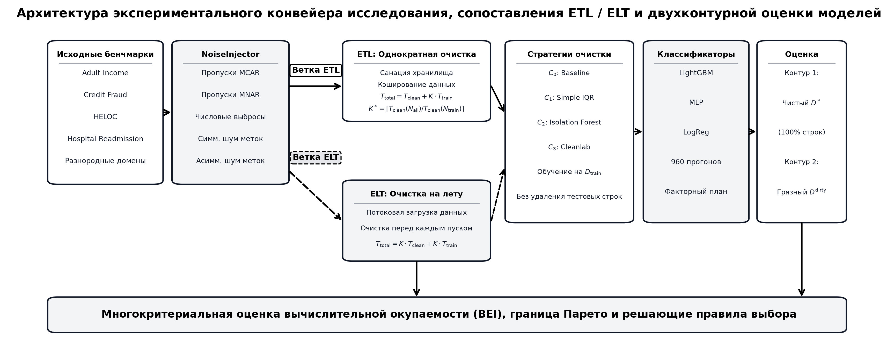
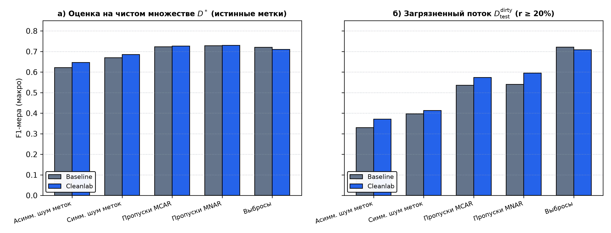
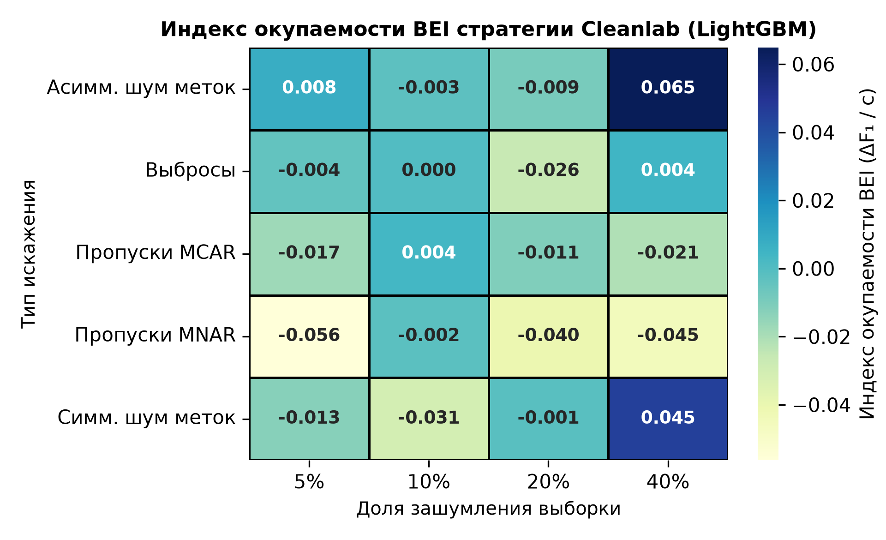
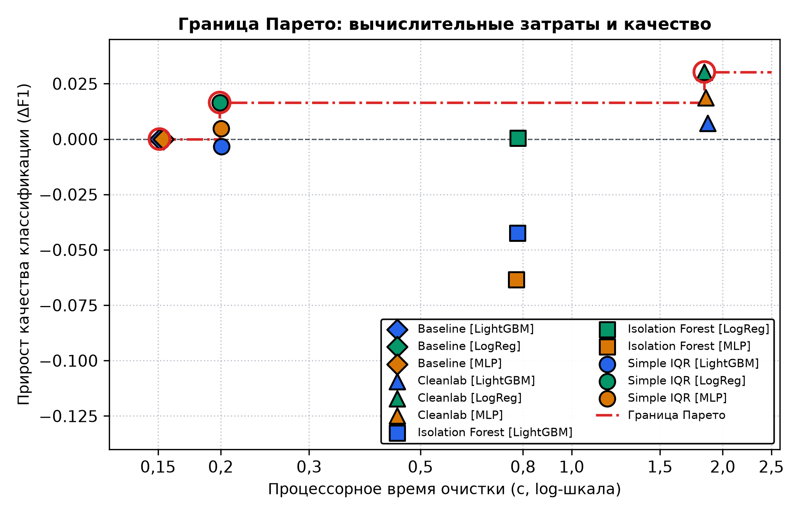

# Cost-Benefit Analysis of Data Cleaning Strategies for ML Models: Break-Even Criteria in Tabular Classification

[](https://www.python.org/downloads/)
[](https://opensource.org/licenses/MIT)
[](https://www.openml.org/)
[-success.svg)](http://vestnik.adygnet.ru/)

Официальный репозиторий и воспроизводимый пакет экспериментов для научной статьи:
> **Ахметшин Р. Р.** Оценка соотношения затрат и выгод стратегий очистки данных для моделей машинного обучения: критерии безубыточности при классификации табличных данных // *Вестник Адыгейского государственного университета. Сер. Естественно-математические и технические науки*, 2026.  
> *(Akhmetshin R. R. Cost-benefit analysis of data cleaning strategies for machine learning models: break-even criteria in tabular data classification // Bulletin of the Adyghe State University. Series: Natural-Mathematical and Technical Sciences, 2026).*

---

## 💡 Краткая суть исследования

В производственных MLOps-конвейерах автоматическая очистка табличных данных требует существенных вычислительных ресурсов (до 81–84% процессорного времени конвейера), однако прирост точности классификаторов часто незначителен или вовсе отсутствует на реальных зашумленных потоках.

В работе проведен контролируемый факторный эксперимент (960 прогонов, 4 разнородных датасета OpenML, 5 типов дефектов, 4 уровня зашумления $`r \in [0{,}05; 0{,}40]`$, 4 стратегии очистки, 3 класса моделей) и сформулированы **формальные критерии экономической целесообразности очистки**:

### Ключевые выводы и критерии:

**1. Критический порог окупаемости переобучения ($`K^*`$)**  
В конвейерах **ETL**  очистка вычислительно оправдана, только если модель переобучается на очищенных данных не менее $`K^*`$ раз:

$$
K^* = \left\lceil \frac{T_{\text{clean}}(N_{\text{all}})}{T_{\text{clean}}(N_{\text{train}})} \right\rceil
$$

* Для быстрых моделей (`LightGBM`): $`K^* \approx 11`$ циклов; для тяжелых (`MLP`): $`K^* \approx 2`$ цикла.
* В потоковых архитектурах **ELT** (очистка «на лету» перед каждым обучением) очистка **всегда убыточна** по суммарному времени ($`K^* \to \infty`$).

---

**2. Показатель удельной вычислительной отдачи Break-Even Index (BEI)**

$$
\text{BEI} = \frac{\Delta F_1}{T_{\text{clean}}}
$$

Высокую вычислительную отдачу обеспечивает исключительно фильтрация шума меток (`Cleanlab`): $`\text{BEI} = 0{,}065`$ при $`r = 0{,}40`$ (40%). Удаление числовых выбросов (`Isolation Forest`, `Simple IQR`) и пропусков дает околонулевой или отрицательный BEI.

---

**3. Парадокс двухконтурной оценки**  
Очистка тренировочной выборки улучшает метрики на идеально чистом тесте ($`D^*`$). Однако на реальном зашумленном потоке ($`D_{\text{test}}^{\text{dirty}}`$ при дефектах $`r \ge 20\%`$) **необработанная базовая модель (`Baseline`) превосходит очищенные модели на 0,03–0,05 по $`F_1`$**, так как сохраняет способность обобщать на искаженных распределениях среды.

---

**4. Недоминируемая граница Парето**  
Из всех комбинаций на границе Парето находятся только две альтернативы:
* **`Baseline`** ($`C_0`$): нулевые вычислительные затраты ($`T_{\text{clean}} = 0{,}15`$ с, $`\Delta F_1 = 0`$);
* **`Cleanlab + LightGBM`** ($`C_3`$): максимальный выигрыш в качестве ($`\Delta F_1 = +0{,}041`$ при $`T_{\text{clean}} = 1{,}85`$ с).  
Стратегии `Isolation Forest` и `Simple IQR` строго доминируются базовым уровнем.

---

**5. Статистическая значимость**  
Значимость различий подтверждена непараметрическим критерием Фридмана ($`\chi^2 = 188{,}75`$, $`p < 10^{-40}`$) и попарными критериями Вилкоксона ($`W = 6297{,}5`$, $`p < 10^{-8}`$) с поправкой Холма-Бонферрони на множественное тестирование.

---

## 📊 Основные иллюстрации статьи

| Рис. 1. Архитектура конвейера (ETL / ELT и $`K^*`$) | Рис. 2. Парадокс двухконтурной оценки ($`D^*`$ vs $`D^{\text{dirty}}`$) |
|:---:|:---:|
|  |  |
| **Рис. 3. Тепловая карта показателя BEI** | **Рис. 4. Недоминируемая граница Парето** |
|  |  |

---

## ⚡ Быстрый старт и воспроизведение

### 1. Установка окружения
```bash
git clone https://github.com/akhmetshin/data-cleaning-benchmark.git
cd data-cleaning-benchmark

python -m venv .venv
# Активация: source .venv/bin/activate (Linux/Mac) или .venv\Scripts\activate (Windows)
pip install -r requirements.txt
```

### 2. Проверка статистических критериев статьи
Запуск расчета критериев Фридмана, Вилкоксона, поправки Холма-Бонферрони и матрицы BEI по готовым логам:
```bash
python scripts/run_statistical_tests.py
```

### 3. Генерация иллюстраций статьи
Построение Рис. 1–4 в папку `figures/` в форматах PNG и PDF:
```bash
python scripts/generate_figures.py
```

### 4. Запуск и инспекция бенчмарка
- Проверить статус выполненных прогонов на диске:
  ```bash
  python scripts/run_benchmark.py --status
  ```
- Быстрый пилотный прогон (Adult и HELOC, 2 уровня шума):
  ```bash
  python scripts/run_benchmark.py --pilot
  ```
- Полный прогон факторного эксперимента (960 условий с сохранением чекпоинтов):
  ```bash
  python scripts/run_benchmark.py --save_every 10 --chunk_size 20
  ```

---

## 📁 Структура репозитория

```text
.
├── LICENSE                            # Лицензия MIT
├── README.md                          # Руководство и описание результатов
├── requirements.txt                   # Зависимости (scikit-learn, lightgbm, cleanlab, scipy)
├── .gitignore                         # Исключения кэша и временных файлов
│
├── data/
│   ├── raw/                           # Исходные выборки (Adult, HELOC, Hospital, Credit Fraud)
│   └── processed/                     # Полные протоколы 960 экспериментов (.csv и .parquet)
│
├── figures/                           # Графика статьи в 300 DPI (PNG, PDF, Grayscale)
│   ├── experimental_pipeline_architecture.png
│   ├── dual_test_paradox.png
│   ├── break_even_heatmap.png
│   └── pareto_frontier.png
│
├── scripts/                           # Точки входа CLI
│   ├── run_benchmark.py               # Запуск экспериментов и мониторинг
│   ├── run_statistical_tests.py       # Статистическая верификация (Фридман, Вилкоксон)
│   └── generate_figures.py            # Построение графиков публикации
│
└── src/                               # Пакет исходного кода бенчмарка
    ├── analysis/stats.py              # Статистический анализ и расчет метрик
    ├── cleaning/strategies.py         # Алгоритмы очистки (Baseline, IQR, IsoForest, Cleanlab)
    ├── data/                          # Загрузка и разбиение датасетов
    ├── models/trainers.py             # Обучение LightGBM, MLP, Logistic Regression
    ├── noise/injector.py              # Внесение синтетических дефектов
    ├── pipeline/runner.py             # Оркестратор экспериментов (seed = 42)
    └── profiling/tracker.py           # Профилирование CPU/RAM, расчет BEI и границы Парето
```

---

## 📜 Лицензия
Код и данные распространяются под лицензией [MIT](LICENSE).
